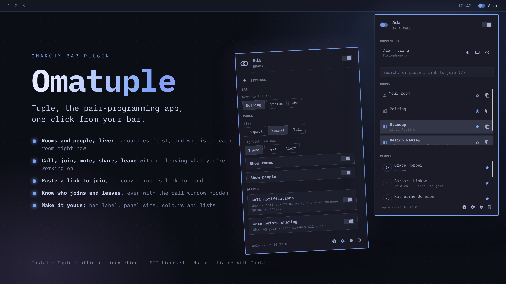
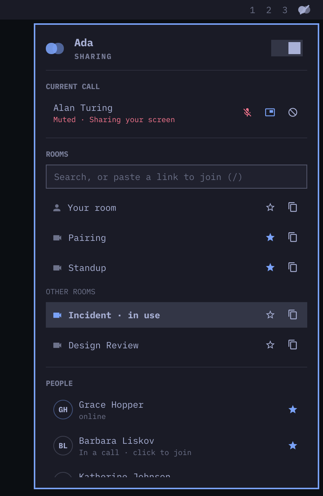
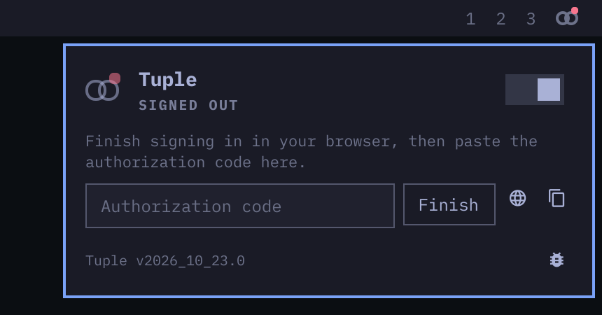

# Tuplet

Tuple, the pair-programming app, in the Omarchy bar. Tuplet installs Tuple's
Linux client for you and gives it the dropdown it doesn't ship with: your
rooms, your people, and call controls, one click from the bar.



## Features

- **Rooms**: one scrolling list with your room first, then favorites A to Z,
  then rooms in use and everything else. Rooms people are in show who is there
  on a second line. One click to join.
- **People**: everyone, with favorites and anyone online or in a call at the
  top. Click to call them, or to join the call they're in.
- **Search**: one field finds any room or person. Paste a call link into it
  and press Enter to join.
- **Calls**: mute, share your screen, leave, and answer incoming calls. The bar
  icon shows when you're in a call and muted.
- **Install and update**: downloads the official client and checks it against
  Tuple's published checksum. Offers updates when Tuple releases one.
- **Diagnose with my agent**: the bug button in the panel hands a problem to
  your default coding agent, which can find the cause and, with your approval,
  open a pull request or issue here. See [Getting help](#getting-help).

| In a call | Signing in |
| --- | --- |
|  |  |

Nothing is polled: Tuple's client pushes every change, so the widget costs
nothing while nothing happens. It runs once for all your monitors.

### Keyboard

With the dropdown open:

| Key | Action |
| --- | --- |
| Arrows, Enter | Move through rooms and people, join or call |
| `/` | Search |
| `m` | Mute or unmute |
| `s` | Share or stop sharing your screen |
| `l` | Leave the call |
| `a` | Answer an incoming call |
| Esc | Close |

Right-click the bar icon during a call to mute.

### Bind keys to calls

```bash
omarchy-shell io.github.gsottnick.tuple mute
omarchy-shell io.github.gsottnick.tuple leave
omarchy-shell io.github.gsottnick.tuple toggle
```

Also `share`, `accept`, `join <link>`, `status`, `open`, `close`, and `diagnose`.

## Requirements

- Omarchy with the Quickshell bar.
- x86_64 or arm64.
- `curl` and `sha256sum` to install the client, both part of Omarchy.
- A Tuple account.

## Install

```bash
omarchy plugin add https://github.com/gsottnick/omarchy-tuple.git --enable
```

The widget lands on the right of the bar. Move it with:

```bash
omarchy bar move io.github.gsottnick.tuple --section left
```

Installed before the plugin id changed (`io.github.gsottnick-eng.tuple`)?
Remove it under the old id and add it again; your Tuple sign-in is unaffected:

```bash
omarchy plugin remove io.github.gsottnick-eng.tuple
omarchy plugin add https://github.com/gsottnick/omarchy-tuple.git --enable
```

Then update any keybindings that call `omarchy-shell io.github.gsottnick-eng.tuple`.

Open the dropdown. If Tuple isn't installed, it offers to install it. Then
**Sign in**: your browser opens Tuple's sign-in page, and you paste the
authorization code it gives you back into the panel.

### How the client gets installed

Tuple's own install command downloads the binary straight onto your `PATH`.
`bin/tuple-install` is more careful. It:

1. asks Tuple's release service for the current version,
2. refuses to download from any host other than Tuple's own,
3. downloads to a temporary directory,
4. checks the SHA-256 Tuple publishes with the release, and
5. only then puts it in `$XDG_BIN_HOME`, or `~/.local/bin` if that isn't set.

Nothing runs as root, and the download is never executed while installing.
Run it yourself if you'd rather:

```bash
./bin/tuple-install                 # install or update
./bin/tuple-install --check         # print the latest version, install nothing
./bin/tuple-install --dest ~/bin    # somewhere else
```

## Settings

| Setting | Default | Meaning |
| --- | --- | --- |
| Show status text next to the bar icon | off | "In call", "Muted" or "Sharing" beside the icon |
| Notify when a call starts or ends | on | A desktop notification, since the client shows none |

From the command line:

```bash
omarchy bar set io.github.gsottnick.tuple showLabel true
omarchy bar set io.github.gsottnick.tuple callAlerts false
```

Tuplet stores nothing about your account. Your rooms, people, and who you're
signed in as come from Tuple every time.

## Remove

```bash
omarchy plugin remove io.github.gsottnick.tuple
```

That removes the widget and its settings. The Tuple client stays, since you
may still want it in a terminal. To remove it too:

```bash
tuple stop
rm -f "$(command -v tuple)"
rm -rf ~/.local/share/tuple       # your Tuple session and client settings
```

## Known issues

These are bugs outside Tuplet — see [`UPSTREAM.md`](UPSTREAM.md) for the full
list, who has to fix each one, and what we're waiting on. The big ones:

- **Starting a screen share crashes Xwayland**, closing every X11 app you have
  open (Steam, Zoom, games). It happened every time in testing, the moment
  Tuple's client started the share. Hyprland does not restart Xwayland, so X11
  apps hang until you log out and back in. Tuplet warns you once per session
  before your first share, and refuses to share again after a crash until you
  log back in. Seen with Tuple v2026_10_23.0 and Xwayland 24.1.14.
- **Screen sharing needs the client's `capture` setting on `auto`**, Tuple's
  default. The `x11` setting fails under Hyprland with
  `X11GetImage failed with UnexpectedX11Event`. If you changed it, set it back:
  `tuple set capture auto`.
- **`share` and `unshare` are deprecated** in Tuple's client, with no
  replacement yet. Tuplet hides the share button if a future client drops
  them. To be resolved by **Tuple**.

## Getting help

Click the bug button in the panel, or run
`omarchy-shell io.github.gsottnick.tuple diagnose`. Omarchy opens your default
coding agent with what Tuplet knows about the problem and a guide for
diagnosing it ([`agents/diagnose/SKILL.md`](agents/diagnose/SKILL.md)). The
agent works out whether it's Tuplet's bug, Tuple's, or Omarchy's. If it's
Tuplet's and it can fix it, it prepares a pull request here. Nothing is posted
without your approval, and your contacts and rooms are kept out of anything it
writes.

Set a default agent first if you haven't: `omarchy default agent <name>`.

You can also [open an issue](https://github.com/gsottnick/omarchy-tuple/issues).

## Development

[`AGENTS.md`](AGENTS.md) has the layout, the rules every change keeps, and how
to run the tests. It is written for coding agents and works for people too.

```bash
node --test tests/
```

## License

MIT. This project is not affiliated with, endorsed by, or supported by Tuple.
"Tuple" is the trademark of its owner.
